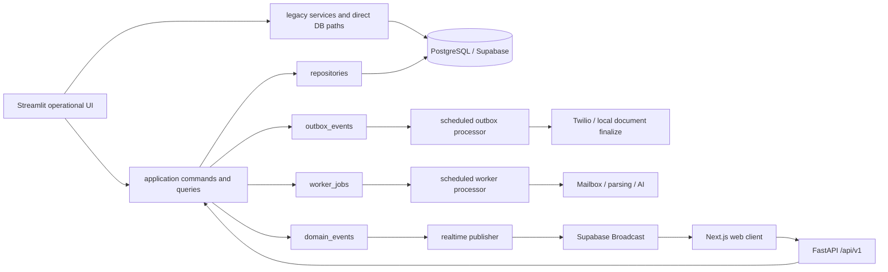

# Calitrans TMS full code review

Reviewed commit: `5faaf0f8007ac0f1e3073761d57282ed7e1a73ce` on `feat/operations-inbox-web`  
Review date: 2026-08-18  
Evidence labels: **Runtime**, **Automated**, **Static**, **Inferred**, **Not verified**.

## Overall verdict

Calitrans is an increasingly coherent transitional TMS, not a production-ready system. The repository has real authentication, command authorization, transactional load/work-item writes, durable worker/outbox/domain-event queues, a certified inbox parser corpus, and a typed Next.js client. The most important safety defect found during this review was that pytest could inherit the application database URL and attempt to contact it; the review patch makes pytest discard that URL unconditionally. No disposable database was positively established, so migrations, seeds, queue processors, and database integration suites were not executed.

## Current architecture summary

## Executive status

- **Confirmed working:** Python imports compile; isolated auth/permission/sample-data safety tests pass; web unit tests, lint, and type checking pass. Atomicity, idempotency, retries, authorization, and event behavior have substantial automated coverage. **Automated/Static**.
- **Partially working:** Next.js covers login, load reads, and the primary Inbox workspace, but most operational workflows remain Streamlit-only. Scheduled processors exist but were not exercised against a disposable database or live providers. **Static/Automated**.
- **Not working or unsafe:** the pre-review pytest guard could reach the application database; uploads have no command-boundary byte limit or content-signature validation; browser/Streamlit tokens remain script-readable; SMS delivery is at-least-once and can duplicate after the provider-success/DB-commit crash window. **Runtime/Static**.
- **Could not be verified:** live PostgreSQL migrations and invariants, inbox certification cases, actual mailbox sync, Twilio, Motive, Port Houston, Supabase Broadcast, GitHub scheduled processing, Streamlit browser workflows, and Playwright against running services. **Not verified**.
- **Top five risks:** unsafe environment separation; XSS-accessible session tokens; unbounded/unverified file uploads; duplicate external side effects; operational dependence on best-effort scheduled jobs without measured alerting.
- **Production-readiness verdict:** **No**. Do not connect a new live production database until environment isolation, secrets rotation, upload controls, staging validation, backup/restore, and operator monitoring are accepted.
- **Recommended next phase:** Safety and staging foundation, followed by transactional/runtime certification on a disposable PostgreSQL database.

## Scorecard

| Area | Score | Evidence |
|---|---:|---|
| Architecture | 3.5/5 | Shared application/repository layers and durable queues exist; large Streamlit/service bypass paths remain. **Static** |
| Correctness | 3.5/5 | Broad regression corpus and CASE-010 implementation tests exist; no full DB/runtime run in this review. **Automated/Not verified** |
| Security | 2.5/5 | Fail-closed API auth and redaction exist; token storage and upload controls remain weak. **Static/Automated** |
| Authorization | 4/5 | Canonical permission matrix plus route and command gates; object-level tenancy is absent because the system is single-company. **Static/Automated** |
| Data integrity | 3.5/5 | Transactions and idempotency indexes cover important flows; many status invariants lack DB checks. **Static** |
| Reliability | 3.5/5 | Claim/retry/backoff/reclaim/operator retry exist; provider exactly-once and continuous worker hosting do not. **Static/Automated** |
| Test coverage | 4/5 | Extensive Python and web tests; browser/live-provider/database coverage is gated or absent. **Automated** |
| Observability | 2/5 | Status/list/inspect CLIs exist; no confirmed metrics, tracing, paging, or SLOs. **Static** |
| API maturity | 3.5/5 | Versioned typed reads and key mutations; legacy endpoints and incomplete workflow coverage remain. **Static/Automated** |
| Web-client maturity | 2.5/5 | Loads and Inbox exist; Dispatch, Documents, Billing, Admin, and integrations remain absent. **Static/Automated** |
| Streamlit retirement readiness | 2/5 | A migration path exists, but Streamlit remains the operational fallback and contains direct/legacy paths. **Static** |
| Integration readiness | 2/5 | Adapters and tests exist; credentials and live contracts were not verified. **Static/Not verified** |
| Production readiness | 1.5/5 | Environment, staging, backup, monitoring, and live acceptance evidence are insufficient. **Verified/Static** |

## Confirmed findings

### CTMS-001 — pytest could contact the application database

- Severity/type: **P1, Security / Data integrity / Test gap**; confidence: High.
- Evidence: `conftest.py::pytest_configure` trusted a pre-existing `DATABASE_URL`; a safe audit run attempted the configured remote connection. **Runtime**.
- Root cause: `.env` loading and caller intent were indistinguishable once Python started.
- Fix in review: pytest now always removes `DATABASE_URL` and clears `config.DATABASE_URL`; database suites retain dedicated disposable URL variables.
- Regression: `tests/test_conftest_database_isolation.py` and `tests/test_sample_data.py`.
- Production blocker: Yes. Effort: S.

### CTMS-002 — uploaded documents have no byte or signature limit

- Severity/type: **P1, Security / Reliability**; confidence: High.
- Evidence: `application.documents.commands.attach_load_document` calls `stage_upload`; `services.document_storage_service.stage_upload` reads the entire file into memory. UI extension filters are not a security boundary. **Static**.
- Impact: memory/disk exhaustion and storage of disguised content.
- Fix: enforce configured maximum size while streaming, validate allowed signatures/content types, quarantine rejects, and test boundary/oversize/spoofed files.
- Production blocker: Yes. Effort: M.

### CTMS-003 — browser and Streamlit session tokens are script-readable

- Severity/type: **P1, Security / Authorization**; confidence: High.
- Evidence: `docs/architecture/WEB_CLIENT.md` documents `sessionStorage` and a script-written Streamlit cookie. **Static**.
- Impact: an XSS defect can steal a 12-hour bearer token.
- Fix: server-set `HttpOnly`, `Secure`, `SameSite` cookie, rotation/revocation, and CSRF protection for mutations.
- Production blocker: Yes. Effort: L.

### CTMS-004 — SMS can be delivered twice after a crash

- Severity/type: **P2, Reliability / Correctness**; confidence: High.
- Evidence: `services.outbox_processor` explicitly provides at-least-once delivery and cannot atomically couple Twilio success to the DB result. **Static**.
- Impact: drivers may receive duplicate dispatch instructions.
- Fix: use provider idempotency if available, otherwise persist a stable provider correlation key and add reconciliation/manual suppression.
- Regression: simulate crash after provider success and before `mark_delivered`.
- Production blocker: Yes for automated driver messaging. Effort: M.

### CTMS-005 — async/status invariants are weakly enforced in PostgreSQL

- Severity/type: **P2, Data integrity**; confidence: High.
- Evidence: outbox, worker, and domain-event migrations use free-text status without check constraints; loads also accept arbitrary statuses. **Static**.
- Impact: direct SQL or a bug can create unclaimable/impossible states.
- Fix: staged cleanup, then check constraints for lifecycle/status fields and nonnegative attempt counts.
- Production blocker: Yes. Effort: M.

### CTMS-006 — production runtime depends on best-effort GitHub schedules

- Severity/type: **P2, Reliability / Observability**; confidence: High.
- Evidence: `.github/workflows/process-jobs.yml` runs every five minutes and documents delay/disable behavior. **Static**.
- Impact: inbox, SMS, documents, and realtime can lag silently.
- Fix: staging measurements first; then a continuously supervised worker or managed scheduler with backlog/age alerts.
- Production blocker: Yes. Effort: L.

### CTMS-007 — legacy and new application paths overlap

- Severity/type: **P2, Technical debt / Correctness**; confidence: High.
- Evidence: Streamlit pages, oversized `operations_inbox_service.py`, application commands, legacy API endpoints, and compatibility DB clients coexist. **Static**.
- Impact: authorization, events, and behavior can diverge by caller.
- Fix: mutation scanner as a required CI check; migrate one workflow at a time; freeze then delete only proven-unreachable paths.
- Blocks Streamlit retirement: Yes. Effort: XL, incremental.

### CTMS-008 — no general CI validation workflow

- Severity/type: **P2, Test gap**; confidence: High.
- Evidence: the only workflow found is scheduled job processing; there is no push/PR Python + web validation workflow. **Static**.
- Impact: regressions can merge without standard checks.
- Fix: PR workflow for compile, safe pytest, web lint/typecheck/test/build, migration static tests, secret scan, and dependency review.
- Production blocker: Yes. Effort: M.

### CTMS-009 — configuration and documentation drift

- Severity/type: **P3, Documentation / Technical debt**; confidence: High.
- Evidence: root README still states the API has no authentication and understates the web/worker/event architecture. **Static**.
- Impact: unsafe operator decisions and incorrect setup.
- Fix: replace root README with current architecture and environment-specific runbooks.
- Production blocker: No. Effort: S.

## Authorization matrix

| Sensitive operation | Dispatcher | Accounting | Manager | Admin | Enforcement |
|---|---:|---:|---:|---:|---|
| View loads/documents | Yes | Yes | Yes | Yes | route role + `LOAD_VIEW` where command applies |
| Edit/cancel/verify load | Yes | No | Yes | Yes | application command permission |
| Dispatch transition/assignment | Yes | No | Yes | Yes | route role + `DISPATCH_TRANSITION` |
| Manage Inbox work item | Yes | No | Yes | Yes | route role + `WORK_ITEM_MANAGE` |
| Attach document | Yes | Yes | Yes | Yes | `DOCUMENT_ATTACH` |
| Send driver message | Yes | No | Yes | Yes | `DRIVER_MESSAGE_SEND` |
| Billing view/edit | No | Yes | Yes | Yes | permission matrix; Streamlit surfaces still require continued audit |
| Master-data edit | No | No | Yes | Yes | `MASTER_DATA_EDIT` |
| User administration | No | No | No | Yes | `USER_ADMIN`; provisioning currently script-oriented |
| Retry worker/outbox/domain event CLI | Operator shell | Operator shell | Operator shell | Operator shell | environment/host access, not app RBAC |

Unknown roles fail closed. Frontend hiding is treated as UX only; application commands are the intended mutation boundary. **Static/Automated**.

## Validation record

| Command | Result | Scope/limitation |
|---|---|---|
| Python `compileall` for app/API/application/workers/realtime/tests | Pass | Syntax/import compilation only |
| Safe full pytest suite | 1,375 passed, 98 skipped, 1 warning in 58.46s | Application DB blocked; DB/certification suites skipped without disposable URLs |
| Targeted safety/auth suite | 39 passed | No DB/provider access; one dependency deprecation warning |
| `npm test` | 9 files, 39 tests passed | Mocked/jsdom, not live services |
| `npm run typecheck` | Pass | TypeScript strict check |
| `npm run lint` | Pass | ESLint |
| Initial audit runs | Invalid as product results | Temp-directory permission errors and unsafe dotenv repopulation exposed CTMS-001; both were isolated before the passing run |
| PostgreSQL integration/certification suites | 98 skipped within safe suite | No disposable database positively established |
| Playwright/live Streamlit/API/provider workflows | Not run | Required services and safe credentials unavailable |

## Streamlit retirement plan

1. Keep Streamlit as fallback while accepting Next.js Inbox with named QA data.
2. Migrate Dispatch Board next because it is operationally central and already has command boundaries.
3. Migrate the load mutation workspace, documents, and communications.
4. Migrate Billing with accounting-role acceptance tests.
5. Retain Admin/Diagnostics temporarily; remove only after equivalent operator tools exist.
6. Freeze each migrated Streamlit page, add parity tests, observe one release, then remove confirmed-unreachable code.

## Recommended next phase

Create an isolated staging PostgreSQL database whose name and identity unmistakably contain `qa` or `staging`; rotate any credentials exposed during prior testing; apply migrations; run the sample dataset; execute the functional matrix; and instrument queue age/failure metrics. Only after that evidence exists should broader feature work continue.
